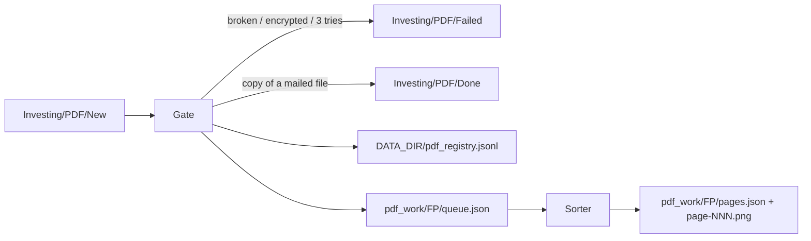

# PDF reader — build plan for steps 1 and 2 (gate, page sorter)

Approved by the user on 2026-11-08, with two corrections: the "only link" rule in slice 8, and the manual trial list in slice 12. Written by Claude; implemented by Grok 4.7, which reads only this file. The rules come from `docs/PDF_READER_PLAN.md` section 10; if this plan and section 10 ever disagree, Grok stops and asks.

## Özet (Türkçe, düz dil)

PDF okuyucunun ilk iki adımı yapılır. İkisinde de model yok.

- **Kapı.** `Investing/PDF/New/`'a düşen PDF'i bulur. Drive eşitlemesi bitmemiş dosyayı o bakışta atlar. Dosyayı içeriğinin parmak iziyle tanır; aynı içerik başka adla gelse de ikinci kez işlenmez. Bozuk ya da şifreli dosyayı hemen `Failed/`'a taşır. Bir okuma üç bakışta da başarısız olursa dosyayı `Failed/`'a taşır.
- **Sayfa ayırıcı.** Her sayfaya iki etiket verir: yazılı mı taranmış mı, içerik mi uyarı mı. Görünmez yazıyı atar. Birkaç sayfaya yayılan tabloları işaretler. Okunacak her sayfanın resmini çıkarır.

Her şey dosyalarla taşınır. Silinmeyen bir kayıt dosyası (`pdf_registry.jsonl`) var. Her PDF için bir çalışma klasörü var; içinde `queue.json`, `pages.json` ve sayfa resimleri durur.

Kod `agents/pdf_reader/` altındadır. `shared/`'dan ve diğer ajanlardan hiçbir şey almaz. Komut: `python -m agents.pdf_reader`.

İş 13 dilime bölünür. Her dilim tek commit olur, kendi testleriyle gelir. Testler kendi küçük PDF'lerini üretir. Banka PDF'leri teste ve commit'e asla girmez.

## Scope

- **In:** rules 1–7 of `docs/PDF_READER_PLAN.md` section 10.3, plus the working-file location of 10.5.
- **Out:** steps 3–7, any model call, any mail (the one-line failure mail of rule 2 is step 7's job), deleting working files (after the mail, or after 14 days for a failed file; step 7's job), any Hermes job, the Air.
- **Must not change:** `shared/`, the other agents, `settings.yaml`, the database, `docs/PDF_READER_PLAN.md`.
- **Packages added:** `pdfplumber`, `pypdfium2` and `pillow` as runtime packages, and `reportlab` as a dev-only package. The already present `pyyaml` and `python-dotenv` are reused; they are not new.



## Data formats

All JSON is UTF-8 and written with `ensure_ascii=False` and `indent=2`. Times are UTC, written `YYYY-MM-DDTHH:MM:SSZ`. A fingerprint is the SHA-256 hex digest of the file's bytes: 64 lowercase characters.

### Registry: `<DATA_DIR>/pdf_registry.jsonl`

- One JSON object per line. Lines are appended only; nothing ever rewrites or deletes the file. It lives outside `pdf_work/`, so it survives when working folders are deleted later.
- Every line has three common fields:
  - `at` (str), for example `"2026-11-08T17:30:00Z"`
  - `event` (str)
  - `fingerprint` (str)
- Allowed events and their extra fields:
  - `queued`: `name` (str), `size_bytes` (int), `page_count` (int)
  - `duplicate`: `name` (the copy's name), `original_name` (str)
  - `duplicate_moved`: `name`, `to` (`"Done"` or `"Failed"`), `new_name` (str)
  - `source_changed`: `old_name`, `name`
  - `attempt_failed`: `name`, `step` (`"sorter"`), `detail` (str, at most 300 characters), `attempt` (int, 1–3)
  - `failed`: `name`, `reason` (`"broken"`, `"encrypted"` or `"three_attempts"`), `detail` (str, at most 300 characters)
  - `sorted`: `name`, `page_count`
  - `mailed`: `name`. This event is reserved for step 7. In this plan only tests write it.
- Example line:

```json
{"at": "2026-11-08T17:30:00Z", "event": "queued", "fingerprint": "3f1c...e9", "name": "Memory price tracker.pdf", "size_bytes": 1834221, "page_count": 32}
```

- A fingerprint's status is the first that applies, in this order:
  - `mailed` if any `mailed` line exists
  - else `failed` if any `failed` line exists
  - else `in_progress` if any `queued` line exists
  - else `new`

### `<DATA_DIR>/pdf_work/<fingerprint>/queue.json` (written by the gate)

```json
{"version": 1, "fingerprint": "3f1c...e9", "source_name": "Memory price tracker.pdf", "size_bytes": 1834221, "page_count": 32, "queued_at": "2026-11-08T17:30:00Z"}
```

`source_name` is the file's name inside `New/`. Only a `source_changed` event rewrites this field.

### `<DATA_DIR>/pdf_work/<fingerprint>/pages.json` (written by the sorter)

Top-level fields:

- `version`: 1
- `fingerprint`: str
- `source_name`: str, the name at sort time
- `sorted_at`: str
- `page_count`: int
- `disclosure_start`: an object or `null`. Example: `{"page": 20, "found_by": "heading", "text": "DISCLOSURE APPENDIX"}`. `found_by` is one of `"bookmark"`, `"heading"`, `"ratings_table"`.
- `notes`: a list of `{"code": str, "page": int|null}`. The codes are:
  - `disclosure_start_not_found` (page `null`)
  - `risks_only_link` (page N)
  - `valuation_only_link` (page N)
- `counts`: an object with:
  - `content`, `content_written`, `content_scanned`
  - `disclosure`, `disclosure_read`
  - `images` (full-page images only; the bottom strips are not counted)
  - `dropped_invisible` (characters dropped, summed over all pages)
- `pages`: a list with one object per page, in page order.

Fields of one page:

- `page` (int, starting at 1)
- `kind`: `"written"` or `"scanned"`
- `kind_reason`: one of `"clean_text"`, `"no_text"`, `"full_page_image"`, `"split_letters"`, `"broken_words"`
- `part`: `"content"` or `"disclosure"`
- `read` (bool)
- `read_sections`:
  - `["all"]` on a content page
  - a sorted list drawn from `"risks"` and `"valuation"` on a read disclosure page
  - `[]` when the page is not read
- `text`: the visible text (str) of a read written page; otherwise `null`
- `dropped_invisible` (int)
- `image`: `"page-001.png"` on a read page; otherwise `null`
- `prev_bottom_image`: `"page-000-bottom.png"`-style name of the bottom strip of page N−1, on a read page with N ≥ 2; otherwise `null`
- `continuation`: `{"status": ..., "header_from_page": int|null, "signs": [...]}`
  - `status` is one of `"none"`, `"continued"`, `"unclear"`, `"not_checked"`
  - `signs` uses this fixed order: `"continued_word"`, `"header_repeated"`, `"columns_match"`

## Package layout (final)

- `agents/pdf_reader/__init__.py`: a docstring listing the modules
- `agents/pdf_reader/__main__.py`: the command (one look)
- `agents/pdf_reader/paths.py`: folders, `.env` and `settings.yaml`
- `agents/pdf_reader/files.py`: atomic JSON writes, `move_unique`, `utc_stamp`
- `agents/pdf_reader/registry.py`: rule 1 store
- `agents/pdf_reader/gate.py`: rules 1–2
- `agents/pdf_reader/visible.py`: rule 6
- `agents/pdf_reader/pagekind.py`: rule 3
- `agents/pdf_reader/disclosure.py`: rules 4–5
- `agents/pdf_reader/continuation.py`: rule 7
- `agents/pdf_reader/images.py`: page images
- `agents/pdf_reader/sorter.py`: step 2, writes `pages.json`
- Tests in `tests/pdf_reader/`:
  - `__init__.py`
  - `conftest.py`
  - `helpers.py` (makes the PDFs)
  - `test_*.py`

Branch: `feat/pdf-reader-steps-1-2`, made from `main`. Before slice 0, Grok runs `uv run pytest -q` and writes the passing count down as N. Each slice ends with all tests passing: N plus that slice's new tests.

---

## Slice 0: packages and skeleton

- **Goal:** add the packages and an empty package that may only import allowed modules.
- **Commands:**
  - `uv add pdfplumber pypdfium2 pillow`
  - `uv add --dev reportlab`
  - These change `pyproject.toml` and `uv.lock`. If either command fails, Grok stops and asks.
  - Then run `uv run python -c "import pypdfium2, pdfplumber; print(pypdfium2.V_PYPDFIUM2, pdfplumber.__version__)"` and put both versions in the commit message.
- **Files:**
  - `agents/pdf_reader/__init__.py`: docstring only
  - `tests/pdf_reader/__init__.py`: empty
  - `tests/pdf_reader/conftest.py`
  - `tests/pdf_reader/test_self_contained.py`
- **`conftest.py`** has one fixture, `pdf_env(tmp_path, monkeypatch)`, with **`autouse=True`**:
  - It sets `DATA_DIR=tmp_path/"data"` and `DRIVE_DIR=tmp_path/"Investing"`.
  - It returns a dict with these keys: `data`, `drive`, `new` (drive/PDF/New), `done`, `failed`.
  - Because it is autouse, no pdf_reader test can ever touch the real Drive.
- **Tests:**
  - `test_package_imports_only_allowed_modules`: parse every `agents/pdf_reader/*.py` with `ast`. The first part of each absolute import must be in `sys.stdlib_module_names`, or be one of `pdfplumber`, `pypdfium2`, `PIL`, `yaml`, `dotenv`, or start with `agents.pdf_reader`. Relative imports are allowed. Expected: passes.
  - `test_no_bank_samples_in_tests`: no file under `tests/pdf_reader/` ends with `.pdf`, and no `.py` file there contains the string `"pdf-" + "samples"` (built by joining, so the test file itself does not match). Expected: passes.
- **Done:** `uv run pytest -q` gives N+2 passing.
- **Commit:** `feat(pdf_reader): slice 0 — packages and skeleton`

## Slice 1: test PDF maker

- **Goal:** one helper that builds every test PDF.
- **File:** `tests/pdf_reader/helpers.py`, with test file `tests/pdf_reader/test_helpers.py`.
- **Functions** (reportlab, A4 = 595.27 × 841.89 pt, y counted from the bottom, as reportlab does):
  - `make_pdf(path: Path, pages: list[list[dict]], *, encrypt: str | None = None, bookmarks: list[tuple[str, int]] | None = None) -> Path`
    - It runs `canvas.Canvas(str(path), pagesize=A4, encrypt=encrypt)` and calls `showPage()` once per page. A blank page is `[]`.
    - For each `(title, page_no)` in `bookmarks`, it runs `c.bookmarkPage(f"b{i}")` and then `c.addOutlineEntry(title, f"b{i}", level=0)` while drawing that page.
  - Operations (dicts) on a page:
    - `{"op": "text", "x": 72, "y": 780, "text": "...", "size": 10, "color": ("gray", 0.0)}`. `size` defaults to 10 and `color` to `("gray", 0.0)`. The color may also be `("rgb", r, g, b)` or `("cmyk", c, m, y, k)`. Drawn with the font `Helvetica` and `drawString`.
    - `{"op": "rect", "x", "y", "w", "h", "color": (...)}`: a filled rectangle with no stroke (`stroke=0, fill=1`).
    - `{"op": "image", "x", "y", "w", "h"}`: draws the PNG from `gray_png`, saved next to the PDF as `<pdf stem>-img.png`.
    - `{"op": "table", "x": 72, "top": 300, "col_widths": [120, 80, 80], "row_height": 18, "rows": [[...], ...]}`:
      - Grid lines are black at width 0.5: one horizontal line at each row edge and one vertical line at each column edge, drawn with `c.line`.
      - Cell text is size 9, drawn at `(cell_x + 3, row_bottom + 5)`.
      - `top` is the y of the top edge.
  - `text_lines(lines: list[str], *, x=72, top=780, step=14, size=10, color=("gray", 0.0)) -> list[dict]`
  - `body(n: int = 12) -> list[str]`: returns n fixed English sentences in turn. The list is exactly these four, repeated:
    - `"Revenue grew 12% in FY26E as memory demand stayed strong."`
    - `"Gross margin improved to 41.5% on better product mix."`
    - `"Management kept its full-year guidance unchanged."`
    - `"Inventory days fell for the third quarter in a row."`
  - `gray_png(path: Path, size=(400, 560), level=180) -> Path`: uses PIL `Image.new("L", size, level)` and saves the PNG.
  - `garbage_pdf(path: Path) -> Path`: writes `b"%PDF-1.4\n%garbage\n" + b"x" * 200`.
- **Tests:**
  - `test_make_pdf_two_pages_readable`: a 2-page file built from `text_lines(body(12))`. `pdfplumber` sees 2 pages, and page 1's text contains `"Revenue grew 12%"`.
  - `test_encrypted_pdf_needs_password`: `encrypt="secret"`. `pypdfium2.PdfDocument` raises `pypdfium2.PdfiumError`, and the message, lowercased, contains `"password"`.
  - `test_table_is_found`: a 3×3 table. `page.find_tables()` gives one table, and `extract()` equals the rows.
  - `test_colors_are_float_tuples`:
    - A rect drawn with `("gray", 0.749)` has `page.rects[0]["fill"] is True` and `non_stroking_color == (0.749,)`. Equality is checked per component within 1e-3, after `tuple()`.
    - A char drawn with `("gray", 0.753)` has `non_stroking_color` of about `(0.753,)`.
    - **If the colour values are not numbers from 0 to 1 in a tuple or list, Grok stops and asks.**
- **Done:** N+6 passing.
- **Commit:** `feat(pdf_reader): slice 1 — test PDF maker`

## Slice 2: paths and file helpers

- **Goal:** find every folder without importing `shared/`.
- **Files:** `agents/pdf_reader/paths.py` and `agents/pdf_reader/files.py`, with test file `tests/pdf_reader/test_paths_files.py`.
- **`paths.py`:**
  - `ROOT = Path(__file__).resolve().parents[2]`
  - `SETTINGS_FILE = ROOT / "settings.yaml"`
  - `ENV_FILE = ROOT / ".env"`
  - At import: `dotenv.load_dotenv(ENV_FILE, override=False)`
  - `class PathsError(Exception)`
  - `data_dir() -> Path`:
    - The value is `os.environ["DATA_DIR"]` if it is set and not empty. Otherwise it is `yaml.safe_load(SETTINGS_FILE.read_text("utf-8"))["paths"]["data_dir"]`.
    - The value goes through `Path(...).expanduser()`.
    - If `DRIVE_DIR` is set and `path.resolve()` lies inside `Path(DRIVE_DIR).expanduser().resolve()` (checked with `is_relative_to`), it raises `PathsError(f"DATA_DIR {path} is inside Drive; working files never go in Drive.")`.
  - `drive_dir() -> Path`: `DRIVE_DIR`, expanded. If it is missing or empty, it raises `PathsError("DRIVE_DIR is not set in .env (the path of the Drive folder `Investing/`).")`.
  - `new_dir()`, `done_dir()`, `failed_dir()`: `drive_dir() / "PDF" / "New"`, then `"Done"`, then `"Failed"`.
  - `work_root()`: `data_dir() / "pdf_work"`
  - `work_dir(fingerprint: str)`: `work_root() / fingerprint`
  - `registry_file()`: `data_dir() / "pdf_registry.jsonl"`
  - `ensure_dirs() -> None`: `mkdir(parents=True, exist_ok=True)` on the New, Done, Failed and work-root folders.
- **`files.py`:**
  - `write_json(path: Path, data: dict) -> None`: makes the parent folders, writes `path.name + ".tmp"`, then calls `os.replace`.
  - `read_json(path: Path) -> dict`
  - `move_unique(src: Path, dst_dir: Path) -> Path`:
    - Makes `dst_dir`. The target is `dst_dir / src.name`.
    - If the target exists, it tries `f"{stem} ({n}){suffix}"` for n = 2, 3, … until a name is free.
    - Moves with `shutil.move` and returns the target.
  - `utc_stamp(now: datetime) -> str`: `now.astimezone(timezone.utc).strftime("%Y-%m-%dT%H:%M:%SZ")`
- **Tests:**
  - `test_data_dir_from_env`
  - `test_data_dir_from_settings_when_env_missing`: delete the `DATA_DIR` env and monkeypatch `paths.SETTINGS_FILE` to a temporary yaml with `paths:\n  data_dir: <tmp>/fromsettings`. The result is that folder.
  - `test_data_dir_tilde_expanded`: yaml `~/pdfx` gives `Path.home()/"pdfx"`.
  - `test_data_dir_inside_drive_refused`: raises `PathsError`.
  - `test_drive_dir_missing`: raises `PathsError`, and the message contains `"DRIVE_DIR"`.
  - `test_folder_names`: New, Done and Failed sit under `drive/PDF`; the registry file and `pdf_work/ab` sit under `data`.
  - `test_ensure_dirs_creates_four_folders`
  - `test_write_json_roundtrip_keeps_turkish`: the file text contains `Şirket`, and no `.tmp` file is left.
  - `test_move_unique_adds_number`: `x.pdf`, then `x (2).pdf`, then `x (3).pdf`; the source file is gone.
  - `test_utc_stamp`: `datetime(2026, 11, 8, 20, 30, tzinfo=ZoneInfo("Europe/Istanbul"))` gives `"2026-11-08T17:30:00Z"`.
- **Done:** N+16 passing.
- **Commit:** `feat(pdf_reader): slice 2 — paths and file helpers`

## Slice 3: registry (rule 1 store)

- **File:** `agents/pdf_reader/registry.py`, with test file `tests/pdf_reader/test_registry.py`.
- **Contents:**
  - `EVENTS = ("queued", "duplicate", "duplicate_moved", "source_changed", "attempt_failed", "failed", "sorted", "mailed")`
  - `class RegistryError(Exception)`
  - `append(event: str, fingerprint: str, now: datetime, **fields) -> dict`
    - An unknown event raises `ValueError` and writes nothing.
    - The line is `{"at", "event", "fingerprint", **fields}`, in that key order.
    - It opens the file with `"a"`, writes the JSON plus `"\n"`, then calls `flush()` and `os.fsync`.
    - It returns the dict.
  - `load() -> list[dict]`
    - A missing file gives `[]`. Blank lines are skipped.
    - A line that is not valid JSON raises `RegistryError(f"registry line {n} is not valid JSON")`, with n counted from 1.
  - `status(records, fingerprint) -> str`: the order in "Data formats".
  - `attempts(records, fingerprint) -> int`: the number of `attempt_failed` lines.
  - `source_name(records, fingerprint) -> str | None`: the `name` of the last `queued` or `source_changed` line.
  - `has_duplicate_note(records, fingerprint, name) -> bool`
  - The module has no function that rewrites or deletes the file.
- **Tests:**
  - `test_load_missing_is_empty`
  - `test_append_adds_one_line_and_keeps_old`: the bytes of line 1 are unchanged after the second append.
  - `test_unknown_event_refused`
  - `test_bad_line_raises`: the message contains `"line 2"`.
  - `test_status_order`: `new`, `in_progress`, `failed`, `mailed`, and `queued` + `failed` + `mailed` together give `mailed`.
  - `test_attempts_counts_only_this_file`
  - `test_source_name_follows_source_changed`
  - `test_has_duplicate_note`
- **Done:** N+24 passing.
- **Commit:** `feat(pdf_reader): slice 3 — registry`

## Slice 4: gate, part 1 (new file, sync wait, fingerprint, broken / encrypted, copies)

- **File:** `agents/pdf_reader/gate.py`, with test file `tests/pdf_reader/test_gate.py`.
- **Constants:**
  - `MIN_AGE_SECONDS = 120`
  - `STABLE_WAIT_SECONDS = 5`
  - `MAX_ATTEMPTS = 3`
- **Drive-sync rule (rule 2).** A file is ready only when all of these hold:
  - its `(st_size, st_mtime_ns)` is the same in two measurements taken `STABLE_WAIT_SECONDS` apart;
  - `st_size > 0`;
  - `now - max(st_mtime, st_ctime) >= MIN_AGE_SECONDS`. Using `ctime` matters: moving or copying a file into `New/` updates it even when Drive keeps an old `mtime`.

  A file that is not ready is skipped in this look. It gets no registry line and is never counted as broken.
- **Ignored names.** These are left alone without a word:
  - directories;
  - names starting with `.` or `~` (Drive's temporary names start with `.`, for example `.tmp.drivedownload`; Office uses `~$`).

  A name whose `suffix.lower() != ".pdf"` is listed as `not_pdf` and left in `New/`.
- **`LookReport` (dataclass), all fields lists, all starting empty:**
  - `queued: list[tuple[str, str, int]]`: (name, fingerprint, page_count)
  - `in_progress: list[tuple[str, str]]`: (name, fingerprint)
  - `source_changed: list[tuple[str, str]]`: (old, new)
  - `duplicates_waiting: list[tuple[str, str]]`: (copy name, original name)
  - `moved: list[tuple[str, str]]`: (name, `"Done"` or `"Failed"`)
  - `failed: list[tuple[str, str, str]]`: (name, reason, detail)
  - `waiting_sync: list[str]`
  - `not_pdf: list[str]`
  - `missing: list[str]`
- **`candidates(folder: Path) -> tuple[list[Path], list[str]]`** returns the PDFs sorted by `name.casefold()` and the names that are not PDFs.
- **`settled(files: list[Path], now: float, sleep=time.sleep) -> tuple[list[Path], list[Path]]`**
  - It measures every file, calls `sleep(STABLE_WAIT_SECONDS)` once (only if there are files), then measures again.
  - It returns `(ready, waiting)`.
  - A file that disappears between the measurements is in neither list.
- **`fingerprint(path) -> str`**: SHA-256 read in 1 MiB chunks.
- **`open_check(path) -> tuple[str | None, int, str]`** returns `(reason, page_count, detail)`:
  1. It runs `pypdfium2.PdfDocument(str(path))`. On `pypdfium2.PdfiumError` the reason is `"encrypted"` if `"password"` appears in the lowercased message, otherwise `"broken"`. The detail is the message, cut to 300 characters.
  2. `n = len(doc)`, then `doc.close()`. If n is 0, the result is `("broken", 0, "the file has no pages")`.
  3. It runs `pdfplumber.open(path)` and takes `m = len(pdf.pages)`. Any exception gives `("broken", 0, f"{type(e).__name__}: {e}"[:300])`. If `m != n`, the result is `("broken", 0, f"page count differs: pdfium {n}, pdfplumber {m}")`.
  4. Otherwise the result is `(None, n, "")`.
- **`look(now: datetime | None = None, sleep=time.sleep) -> LookReport`**
  1. Run `paths.ensure_dirs()`. Load the registry into `records` (`RegistryError` propagates). `now` defaults to `datetime.now(timezone.utc)`.
  2. Run `candidates(new_dir())`, then `settled(...)`. Waiting files go to `waiting_sync`.
  3. Group the ready files by fingerprint, keeping name order inside each group. Every `registry.append` result is also added to `records`.
  4. For each group, by `status`:
     - **`new`:** take the first file and run `open_check` on it.
       - If it fails: `move_unique` it to `Failed/`, append `failed` (with name, reason and detail), and add it to `report.failed`. Every other file of the group goes to `Failed/` with a `duplicate_moved` line (`to="Failed"`).
       - If it opens: make `work_dir(fp)`, write `queue.json`, append `queued`, and add it to `report.queued`. Every other file gets one `duplicate` line (with `original_name`), stays in `New/`, and is added to `duplicates_waiting`.
     - **`in_progress`:** let `src = source_name(records, fp)`.
       - If a file named `src` is in the group, it is the source: add it to `in_progress`.
       - If not, the first file becomes the source: append `source_changed` (`old_name=src`), rewrite `source_name` in `queue.json`, and add it to `report.source_changed` and `in_progress`.
       - Every other file is a copy: append a `duplicate` line only if `has_duplicate_note` is False, leave it in `New/`, and add it to `duplicates_waiting`. A copy is never queued, sorted or mailed.
     - **`mailed`:** every file goes to `Done/` with `move_unique` and a `duplicate_moved` line (`to="Done"`), and is added to `moved`.
     - **`failed`:** the same, but to `Failed/` (`to="Failed"`).
  5. **Missing:** for every fingerprint with status `in_progress` that has no ready file in this look, if `new_dir()/source_name` does not exist, add `source_name` to `missing`. This writes no registry line, and the status stays `in_progress`.
- **Tests.** Unless a test says otherwise, each uses `now = datetime.now(timezone.utc) + timedelta(minutes=10)` and `sleep=lambda s: None`. Good PDFs come from `make_pdf(..., [text_lines(body(12))] * 2)`.
  - `test_empty_new_folder`: every list is empty, and the New, Done and Failed folders exist.
  - `test_good_pdf_is_queued`:
    - `queued == [("a.pdf", fp, 2)]`;
    - `queue.json` has exactly the six fields, with `source_name` `"a.pdf"` and `page_count` 2;
    - the registry has one `queued` line;
    - `a.pdf` is still in `New/`.
  - `test_second_look_does_not_queue_again`: the file is in `in_progress`, and the registry still has exactly one `queued` line.
  - `test_fresh_file_waits_for_sync`: real `now`. Result: `waiting_sync == ["a.pdf"]`, nothing queued, and the registry file does not exist.
  - `test_file_changing_waits`: the `sleep` passed in appends `b"x"` to the file. Result: it is in `waiting_sync`.
  - `test_empty_file_waits`: a 0-byte `a.pdf` is in `waiting_sync`.
  - `test_temp_and_hidden_names_ignored`:
    - `.~tmp.pdf`, `~$a.pdf`, `.hidden.pdf` and a folder named `folder.pdf` appear in no list;
    - `notes.txt` is in `not_pdf`;
    - `A.PDF` is queued.
  - `test_renamed_copy_same_look`:
    - `a.pdf` and `b.pdf` have the same bytes;
    - `a.pdf` is queued, and `duplicates_waiting == [("b.pdf", "a.pdf")]`;
    - both files are still in `New/`;
    - the registry has one `queued` line and one `duplicate` line.
  - `test_copy_later_noted_once`: a copy added at look 2 and still there at look 3 gives exactly one `duplicate` line.
  - `test_broken_goes_to_failed`:
    - `garbage_pdf` gives `failed == [("bad.pdf", "broken", <detail>)]`;
    - the file is in `Failed/` and gone from `New/`;
    - no `pdf_work/<fp>` folder exists.
  - `test_encrypted_goes_to_failed`: reason `"encrypted"`.
  - `test_same_broken_bytes_again_moved_to_failed`: the same garbage bytes as `bad2.pdf` at a later look give `moved == [("bad2.pdf", "Failed")]` and one `duplicate_moved` line.
  - `test_failed_name_collision`: `Failed/bad.pdf` already exists, and a different broken `bad.pdf` ends up as `Failed/bad (2).pdf`.
- **Done:** N+37 passing.
- **Commit:** `feat(pdf_reader): slice 4 — gate: new files, sync wait, fingerprint, broken and encrypted, copies`

## Slice 5: gate, part 2 (finished originals, renamed source, three tries)

- **File:** `agents/pdf_reader/gate.py` (same file). Tests are added to `tests/pdf_reader/test_gate.py`.
- **Function:** `record_attempt_failure(fingerprint: str, step: str, detail: str, now: datetime | None = None) -> tuple[int, bool]`
  - It loads the registry, takes `n = attempts + 1`, and appends `attempt_failed` with `name=source_name`, `step`, `detail[:300]` and `attempt=n`.
  - If `n >= MAX_ATTEMPTS`:
    - if `new_dir()/source_name` exists, it is moved with `move_unique` to `Failed/`;
    - `failed` is appended with `reason="three_attempts"` and `detail=detail[:300]`;
    - it returns `(n, True)`.
  - Otherwise it returns `(n, False)`.
- **Tests:**
  - `test_copy_of_mailed_file_goes_to_done`:
    - queue `a.pdf`, move it by hand to `Done/`, and append `mailed` (as step 7 will);
    - drop `b.pdf` with the same bytes;
    - result: `moved == [("b.pdf", "Done")]`, the file is in `Done/`, and there is one `duplicate_moved` line with `to "Done"`.
  - `test_mailed_file_never_queued_again`: the same bytes as `c.pdf` are moved to `Done/`, and no new `queued` line is written.
  - `test_three_failures_move_to_failed`:
    - the 1st and 2nd calls return `(1, False)` and `(2, False)`, and the file stays in `New/`;
    - the 3rd returns `(3, True)`, the file is in `Failed/`, and `status == "failed"`.
  - `test_waiting_copy_follows_failed_original`: after three failures, the next look moves copy `b.pdf` to `Failed/`.
  - `test_renamed_source_is_followed`:
    - queue `a.pdf`, then rename it to `z.pdf`;
    - result: `source_changed == [("a.pdf", "z.pdf")]`, `queue.json` `source_name` is `"z.pdf"`, and `in_progress == [("z.pdf", fp)]`.
  - `test_missing_source_reported`: queue `a.pdf`, then delete it. Result: `missing == ["a.pdf"]`, no new registry line, and the status is `in_progress`.
- **Done:** N+43 passing.
- **Commit:** `feat(pdf_reader): slice 5 — gate: finished originals, renamed source, three tries`

## Slice 6: invisible text (rule 6)

This slice comes before page kind because rules 3, 4 and 7 all work on the visible text.

- **File:** `agents/pdf_reader/visible.py`, with test file `tests/pdf_reader/test_visible.py`.
- **Threshold:** `SAME_COLOR = 0.01`.
  - Why: on the 0–1 scale, 0.01 is about 2.5 of 255 steps, which the eye cannot tell apart.
  - The sample's "#N/A" cells differ by 0.004 (text 0.753, fill 0.749).
  - The lightest real grey text on white differs by about 0.15 or more.
- **Functions:**
  - `to_rgb(color) -> tuple[float, float, float] | None`
    - It accepts a tuple or list of int and float values, each from 0 to 1. Anything else, including `None`, a str, or a value above 1, gives `None`.
    - 1 value is grey: `(g, g, g)`.
    - 3 values are RGB, returned as they are.
    - 4 values are CMYK: `((1-c)*(1-k), (1-m)*(1-k), (1-y)*(1-k))`.
    - Any other length gives `None`.
  - `same_color(a, b) -> bool`: `max(abs(x - y)) <= SAME_COLOR`
  - `is_invisible(char: dict, rects: list[dict], images: list[dict]) -> bool`
    - `text = to_rgb(char["non_stroking_color"])`. If it is `None`, return False.
    - The centre is `cx = (x0 + x1) / 2`, `cy = (top + bottom) / 2`.
    - If the centre lies inside any image box, return False. Nothing can be said about colour over a picture; this keeps white titles on cover photos.
    - The fill under the text is the **smallest-area** rect with `fill` True that contains the centre. Its colour comes from `to_rgb(rect["non_stroking_color"])`; if that is `None`, return False.
    - If no such rect exists, the colour under the text is page white `(1, 1, 1)`.
    - Return `same_color(text, under)`.
  - `visible_page(page) -> tuple[page_like, int]`
    - It returns `page.filter(lambda o: not (o.get("object_type") == "char" and is_invisible(o, page.rects, page.images)))`.
    - The count is the number of dropped chars whose `text.strip()` is not empty.
- **Known limits, written in the module docstring:**
  - Only rects are fills (curves are not).
  - Text-render mode 3 (OCR layers) is not detected; scanned pages are not trusted anyway.
- **Tests:**
  - `test_to_rgb_forms`:
    - `(0.5,)` gives `(0.5, 0.5, 0.5)`;
    - `(1, 0, 0)` is unchanged;
    - `(0, 0, 0, 1)` gives `(0, 0, 0)`;
    - `(0, 0, 0, 0)` gives `(1, 1, 1)`;
    - `None`, `"P1"`, `(2,)` and `(0.1, 0.2)` give `None`.
  - `test_same_color_threshold`: 0.753 against 0.749 is True; 0.85 against 1.0 is False.
  - `test_grey_on_grey_dropped`:
    - a rect `("gray", 0.749)` at (72, 700, 60, 16), with `"#N/A"` `("gray", 0.753)` at (75, 704);
    - black `"Revenue 12.3"` at (72, 650);
    - result: the visible text contains `"Revenue 12.3"` and not `"#N/A"`, and dropped == 4.
  - `test_white_on_white_page_dropped`: white text `"HIDDEN"` with no rect gives dropped == 6.
  - `test_light_grey_on_white_kept`: grey 0.85 text is kept.
  - `test_cmyk_and_rgb_compared_in_one_system`:
    - CMYK `(0, 0, 0, 0.25)` text on a grey 0.75 rect is dropped;
    - RGB `(0.75, 0.75, 0.75)` text on a grey 0.75 rect is dropped.
  - `test_white_text_on_image_kept`
  - `test_smallest_fill_wins`:
    - a dark 0.2 rect covers the page, with a white rect inside it;
    - white text in the white rect is dropped;
    - white text on the dark area is kept.
- **Done:** N+51 passing.
- **Commit:** `feat(pdf_reader): slice 6 — invisible text`

## Slice 7: written or scanned (rule 3)

- **File:** `agents/pdf_reader/pagekind.py`, with test file `tests/pdf_reader/test_pagekind.py`.
- **Constants:**
  - `MIN_CHARS = 30`
  - `FULL_PAGE_IMAGE_SHARE = 0.85`
  - `MIN_LETTER_WORDS = 20`
  - `SPLIT_LETTER_SHARE = 0.30`
  - `BROKEN_WORD_SHARE = 0.05`
- **Functions:**
  - `image_share(page) -> float`: the largest image's area, clipped to the page box, divided by the page area. With no image it is 0.0.
  - `split_letter_share(words: list[str]) -> float`
    - The letter words are those where `w.isalpha()`.
    - If there are fewer than `MIN_LETTER_WORDS`, the result is 0.0.
    - Otherwise it is the share of letter words that have length 1 and whose `casefold()` is not in `{"a", "i"}`.
  - `broken_word_share(words) -> float`: the share of words containing `"\ufffd"` or `"(cid:"`. With no words it is 0.0.
  - `classify(visible) -> tuple[str, str]`, applied in this order:
    1. If there are fewer than 30 non-blank chars: `("scanned", "no_text")`.
    2. If `image_share >= 0.85`: `("scanned", "full_page_image")`.
    3. Take `words = [w["text"] for w in visible.extract_words()]`. If `split_letter_share > 0.30`: `("scanned", "split_letters")`.
    4. If `broken_word_share > 0.05`: `("scanned", "broken_words")`.
    5. Otherwise: `("written", "clean_text")`.
- **Tests:**
  - `test_clean_page_written`: `body(30)` gives `("written", "clean_text")`.
  - `test_empty_page_scanned`: `("scanned", "no_text")`.
  - `test_few_chars_scanned`: the text `"Page 3"` gives `no_text`.
  - `test_full_page_image_scanned`: an image over the whole page with `body(20)` drawn on top gives `("scanned", "full_page_image")`.
  - `test_half_page_image_written`: an image covering half the page plus `body(20)` gives `written`.
  - `test_split_letters_scanned`: 20 lines of `"p r o f i t  m a r g i n  r o s e"` give `("scanned", "split_letters")`.
  - `test_split_letter_share_values`:
    - `["a", "I", "b"] * 10` gives 10/30 ≈ 0.333;
    - 19 letter words give 0.0.
  - `test_broken_word_share_boundary`: `["(cid:12)abc", "\ufffdx"] + ["w"] * 38` gives exactly 0.05, which is **not** above the threshold.
- **Done:** N+59 passing.
- **Commit:** `feat(pdf_reader): slice 7 — written or scanned`

## Slice 8: start of the disclosures, Risks and Valuation (rules 4–5)

- **File:** `agents/pdf_reader/disclosure.py`, with test file `tests/pdf_reader/test_disclosure.py`. Everything here is pure functions on titles and lines; the PDF-level test is in slice 10.
- **Constants:**
  - `DISCLOSURE_HEADINGS = ("disclosure appendix", "important disclosures", "analyst certification", "required disclosures")`
  - `RATINGS_SIGNS = ("ratings distribution", "rating distribution", "distribution of ratings")`
  - `FIRST_POSSIBLE_PAGE = 2` (a cover page never starts the disclosures)
  - `RISKS_HEADING = re.compile(r"^(?:[^:]{1,60}: )?(?:key |investment )?risks(?: to (?:our )?(?:rating|price target|thesis|view))?$")`
  - `VALUATION_HEADING = re.compile(r"^(?:[^:]{1,60}: )?valuation methodology(?: and risks)?$")`
  - `URL = re.compile(r"https?://\S+|www\.\S+", re.IGNORECASE)`
  - `LINK_ONLY_MAX_WORDS = 60`. Why 60: Bernstein's real "link only" text has the link plus a mailing address, and about 38 words remain once the link is removed. A real Risks or Valuation section is a paragraph or more, well over 60 words.
  - `SECTION_MAX_LINES = 15`
- **Functions:**
  - `normalize(line: str) -> str`: NFKC, then `casefold()`, then runs of whitespace become one space, then `strip()`, then `strip(" :.-–—|")`, then `strip()` again.
  - `is_disclosure_heading(line) -> bool`: `normalize(line) in DISCLOSURE_HEADINGS`. The **whole line** must be the heading, so a sentence that contains the words never counts.
  - `toc_start(toc: list[tuple[str, int]]) -> tuple[int, str] | None`: the smallest page ≥ 2 whose normalized title **starts with** one of the headings, returned with its title.
  - `find_start(toc, page_lines: list[list[str]]) -> dict | None`, tried in this order:
    1. Bookmarks: `{"page", "found_by": "bookmark", "text": title}`.
    2. The first page ≥ 2 with a line where `is_disclosure_heading` is True: `found_by "heading"`, with `text` set to `line.strip()`.
    3. The first page ≥ 2 with a line whose normalized text contains one of `RATINGS_SIGNS`: `found_by "ratings_table"`.
    4. Otherwise `None`.
  - `sections_on_page(lines: list[str]) -> list[dict]`
    - For each line: a `VALUATION_HEADING` match gives `{"section": "valuation", "line": i, "only_link": ...}`, plus a `"risks"` entry for the same line if the match ends with `"and risks"`. Otherwise a `RISKS_HEADING` match gives `"risks"`.
    - The section body is the next lines. It ends at the first of these:
      - a line that is any heading (disclosure, risks or valuation);
      - a line where `is_caps_heading` is True (for example `"RATINGS DEFINITIONS, BENCHMARKS AND DISTRIBUTION"`);
      - `SECTION_MAX_LINES` lines.
    - `only_link` is `URL.search(body) is not None and len(URL.sub(" ", body).split()) <= LINK_ONLY_MAX_WORDS`. The body is the body lines joined with one space.
  - `is_caps_heading(line: str) -> bool`: let `s = line.strip()`. True only when all three hold:
    - `s == s.upper()`;
    - `s` has at least one letter;
    - at least two of `s.split()` contain a letter.

    So `"NY 10167."` is False (only one word with letters) and `"RATINGS DEFINITIONS, BENCHMARKS AND DISTRIBUTION"` is True.
- **Tests:**
  - `test_normalize`: `"  IMPORTANT   DISCLOSURES: "` gives `"important disclosures"`.
  - `test_headings_alone_are_headings`: `"DISCLOSURE APPENDIX"`, `"Important Disclosures"`, `"Analyst Certification"`, `"Required Disclosures"` and `"Important Disclosures:"` are all True.
  - `test_bernstein_cover_sentence_is_not_a_start`: `"See the Disclosure Appendix of this report for important disclosures and analyst certifications."` is False.
  - `test_jpm_cover_sentence_is_not_a_start`: `"See page 13 for analyst certification and important disclosures, including non-US analyst disclosures."` is False.
  - `test_appendix_alone_is_not_a_start`: `"Appendix"`, `"APPENDIX – FINANCIAL FORECASTS"` and `"Important disclosures follow"` are all False.
  - `test_bookmark_first`: toc `[("Important Disclosures", 5)]` gives page 5, `"bookmark"`.
  - `test_bookmark_on_page_one_ignored`: toc `[("Important Disclosures", 1)]` with no heading lines gives `None`.
  - `test_heading_after_sentences`:
    - page 1 has the Bernstein sentence; page 2 has the J.P. Morgan sentence;
    - page 3 has `"APPENDIX – FINANCIAL FORECASTS"`; page 4 has `"Disclosure Appendix"`;
    - result: page 4, `"heading"`.
  - `test_ratings_table_fallback`: page 3 has `"Distribution of Ratings/IB Services"`. Result: page 3, `"ratings_table"`.
  - `test_not_found`: `None`.
  - `test_sections_found`:
    - lines: `"SK hynix: Valuation Methodology"`, a 30-word sentence, `"Risks"`, a 30-word sentence;
    - result: `[{"section": "valuation", "line": 0, "only_link": False}, {"section": "risks", "line": 2, "only_link": False}]`.
  - `test_risks_only_link`: `["Risks", "Please see www.example.com/risks for risks."]` gives `only_link` True.
  - `test_valuation_only_link`: `["Valuation methodology", "See https://example.com/valuation"]` gives True.
  - `test_link_with_real_text_not_only_link`: a URL plus 70 words gives False.
  - `test_risk_heading_forms`:
    - `"Key Risks"`, `"Risks to our rating"` and `"Investment risks"` match;
    - `"Risk factors include a weaker cycle."` does not;
    - `"Valuation methodology and risks"` gives both sections.
  - `test_bernstein_link_and_address_only_link`. The lines are, in this order:
    1. `"VALUATION METHODOLOGY"`
    2. `"This research publication covers six or more companies. For valuation methodology and other company disclosures: Please visit: https://bernstein-autonomous.bluematrix.com/sellside/Disclosures.action. Or, you can also write to the Director of Compliance, Bernstein Institutional Services LLC, 245 Park Avenue, New York, NY 10167."`
    3. `"RISKS"`
    4. `"This research publication covers six or more companies. For risks and other company disclosures: Please visit: https://bernstein-autonomous.bluematrix.com/sellside/Disclosures.action. Or, you can also write to the Director of Compliance, Bernstein Institutional Services LLC, 245 Park Avenue, New York, NY 10167."`
    5. `"RATINGS DEFINITIONS, BENCHMARKS AND DISTRIBUTION"`
    6. a paragraph of 80 words with no URL

    Result: `[{"section": "valuation", "line": 0, "only_link": True}, {"section": "risks", "line": 2, "only_link": True}]`. Line 6 must not be part of the risks body: without the capitals stop it would push the word count past 60.
  - `test_caps_heading`: `"RATINGS DEFINITIONS, BENCHMARKS AND DISTRIBUTION"` is True; `"NY 10167."`, `"Risks"` and `"This is a sentence."` are False.
- **Done:** N+76 passing.
- **Commit:** `feat(pdf_reader): slice 8 — start of the disclosures, Risks and Valuation`

## Slice 9: tables over several pages (rule 7)

- **File:** `agents/pdf_reader/continuation.py`, with test file `tests/pdf_reader/test_continuation.py`.
- **Constants:**
  - `EDGE_SHARE = 0.25`
  - `COLUMN_TOLERANCE_PT = 3.0`
  - `CONTINUED_LINE = re.compile(r"(?:\(|\b)(?:continued|cont'd|cont\.)\)?\s*$", re.IGNORECASE)`. It is matched on the end of a line, so `"growth continued to slow"` does not count.
- **Functions:**
  - `table_shapes(page) -> list[dict]`
    - For each table from `page.find_tables()` (the default "lines" strategy), it gives `{"top", "bottom", "columns", "header"}`, sorted by `top`.
    - `columns` comes from the first row whose cells are all not `None`: `[c[0] for c in cells] + [cells[-1][2]]`. If there is no such row, it is `None`.
    - `header` is `[normalize(cell or "") for cell in table.extract()[0]]`, using `disclosure.normalize`.
  - `has_continued_line(lines: list[str]) -> bool`
  - `top_lines(page) -> list[str]`: `(page.crop((0, 0, page.width, page.height * EDGE_SHARE)).extract_text() or "").split("\n")`
  - `columns_match(a, b) -> bool`: both not `None`, the same length of at least 3 edges (two columns), and every edge within 3.0 pt.
  - `header_repeated(a, b) -> bool`: the headers are equal and have at least 2 non-empty cells.
  - `judge(prev, cur) -> dict`, returning `{"status", "signs"}`:
    - `continued_word` is a sign if `has_continued_line(top_lines(cur))`.
    - If both pages have tables, let `last = prev_tables[-1]` and `first = cur_tables[0]`:
      - `runs_over = last["bottom"] >= prev.height * 0.75 and first["top"] <= cur.height * 0.25`;
      - `header_repeated(last, first)` is a sign;
      - `runs_over and columns_match(...)` is the sign `columns_match`.
    - The status is `"continued"` if there is any sign. Otherwise it is `"unclear"` if both pages have tables and `runs_over` holds. Otherwise it is `"none"`.
- **Known limit, in the docstring:** tables without ruling lines are not detected. Such a page gets `"none"`, so the manual trial checks this.
- **Tests.** Each is a 2-page PDF made with table ops.
  - The previous table has `"top": 300` (reportlab y) and 8 rows of 18 pt, so its pdfplumber bottom is about 686, which is ≥ 631.4.
  - The current table has `"top": 800`, so its pdfplumber top is about 42, which is ≤ 210.
  - `test_same_columns_runs_over`: different first rows give `{"status": "continued", "signs": ["columns_match"]}`.
  - `test_header_repeated_and_columns`: gives `["header_repeated", "columns_match"]`.
  - `test_continued_word`: the line `"Figure 24: Valuation (continued)"` at y 820, plus a table with other column widths, gives `continued` and `["continued_word"]`.
  - `test_word_inside_sentence_not_a_sign`: `"Growth continued to slow in 3Q."` at the top, with no tables, gives `none` and `[]`.
  - `test_runs_over_but_columns_differ_unclear`: `{"status": "unclear", "signs": []}`.
  - `test_prev_table_ends_mid_page_none`: the previous table has `"top": 600` and 4 rows, so it does not reach the bottom quarter. Result: `none`.
  - `test_no_tables_none`
  - `test_continued_line_forms`: `"Figure 24 (continued)"`, `"Table 3 (cont'd)"` and `"Continued"` are True; `"growth continued to slow"` is False.
- **Done:** N+84 passing.
- **Commit:** `feat(pdf_reader): slice 9 — tables over several pages`

## Slice 10: page images and pages.json (step 2 put together)

- **Files:** `agents/pdf_reader/images.py` and `agents/pdf_reader/sorter.py`, with test file `tests/pdf_reader/test_sorter.py`.
- **`images.py`:**
  - Constants: `IMAGE_DPI = 200`, `BOTTOM_SHARE = 0.30`.
  - `render(doc, page_no: int) -> PIL.Image.Image`: `doc[page_no - 1].render(scale=IMAGE_DPI / 72).to_pil()`.
  - `save_images(pdf_path: Path, folder: Path, read_pages: list[int]) -> dict[int, dict]`
    - For each read page p, it saves `page-{p:03d}.png`.
    - If p ≥ 2, it renders page p−1, crops `(0, round(h * (1 - BOTTOM_SHARE)), w, h)` and saves `page-{p-1:03d}-bottom.png`.
    - It returns `{p: {"image": name, "prev_bottom_image": name | None}}`.
- **`sorter.py`:**
  - `toc_entries(doc) -> list[tuple[str, int]]`: for each `item in doc.get_toc()`:
    - if it has `get_title` (pypdfium2 5): the title is `item.get_title()`, and the index is `item.get_dest().get_index()` when the destination exists;
    - otherwise (pypdfium2 4): the title is `item.title` and the index is `item.page_index`;
    - an entry whose index is `None` is skipped; page = index + 1.
    - **If the bookmark test fails with the installed version, Grok stops and asks.**
  - `sort_pdf(pdf_path: Path, work_dir: Path, fingerprint: str, source_name: str, now: datetime) -> dict`
    1. Open both libraries. Get `toc` with `toc_entries`.
    2. Pass over the pages in order. For each page:
       - run `visible_page`, then `classify`;
       - `lines = (visible.extract_text() or "").split("\n")`;
       - run `judge(prev_visible, visible)` when the page number is at least 2 and both pages are `written`; otherwise the result is `None`;
       - keep `prev_visible`.
    3. Run `disclosure_start = find_start(toc, all_lines)`. Every page ≥ its `page` is `disclosure`; the rest are `content`. If it is `None`, add the note `disclosure_start_not_found` (page `null`) and every page is `content`.
    4. Content pages get `read` True and `["all"]`. A disclosure page gets `read = bool(sections_on_page(lines))`, with `read_sections` sorted and unique. Each section with `only_link` adds the note `risks_only_link` or `valuation_only_link`, with that page.
    5. Continuation:
       - page 1, or any page that is not read: `{"status": "none", "header_from_page": null, "signs": []}`;
       - a read page where this page or the one before is scanned: `"not_checked"`;
       - otherwise the `judge` result.
       - For `continued`, `header_from_page` is the previous page's `header_from_page` if that page is itself `continued`, otherwise the previous page's number. For every other status it is `null`.
    6. `text` is the visible text of read written pages; otherwise `null`.
    7. Run `save_images` for the read pages.
    8. Work out `counts`. Write `pages.json` last, with `files.write_json`, so the file existing means the sort is complete.
  - `run(work_dir: Path, now: datetime | None = None) -> dict`
    - It reads `queue.json` and takes `pdf = paths.new_dir() / queue["source_name"]`.
    - If that file is missing, it raises `FileNotFoundError`.
    - Otherwise it returns `sort_pdf(...)`.
- **Test `test_sorter_six_page_report`.** The PDF it builds:
  - **p1:** `"Memory Weekly"` plus `body(12)`.
  - **p2:** `body(8)`, both cover sentences as separate lines (the Bernstein one and the J.P. Morgan one), and a table at `"top": 300`, 8 rows, columns `[120, 80, 80]`.
  - **p3:** a table at `"top": 800` with columns `[120, 80, 80]`. One cell is `"#N/A"` in grey 0.753 over a grey 0.749 rect. Below it, the line `"APPENDIX – FINANCIAL FORECASTS"` and `body(6)`.
  - **p4:** a full-page image with `body(20)` on top.
  - **p5:** `"Disclosure Appendix"` plus `body(10)`.
  - **p6:** `"SK hynix: Valuation Methodology"`, a 30-word sentence, `"Risks"`, then `"Please see www.example.com/risks for risks."`.

  Expected results:
  - `disclosure_start == {"page": 5, "found_by": "heading", "text": "Disclosure Appendix"}`
  - kinds: p1–p3 written, p4 scanned (`full_page_image`), p5–p6 written
  - parts: p1–p4 content, p5–p6 disclosure
  - read: every page except p5
  - `read_sections`: `["all"]` on p1–p4, `[]` on p5, `["risks", "valuation"]` on p6
  - images: files `page-001.png` to `page-004.png` and `page-006.png` exist; `page-005.png` does not
  - `prev_bottom_image`: p2 `page-001-bottom.png`, p3 `page-002-bottom.png`, p4 `page-003-bottom.png`, p6 `page-005-bottom.png`; null on p1 and p5
  - `page-001.png` is 1653 ± 1 by 2339 ± 1 pixels; the bottom strip's height is 702 ± 1
  - continuation: p3 `{"status": "continued", "header_from_page": 2, "signs": ["columns_match"]}`, p4 `not_checked`, p1, p5 and p6 `none`
  - p3's `text` does not contain `"#N/A"`, and its `dropped_invisible` is 4
  - `notes == [{"code": "risks_only_link", "page": 6}]`
  - `counts == {"content": 4, "content_written": 3, "content_scanned": 1, "disclosure": 2, "disclosure_read": 1, "images": 5, "dropped_invisible": 4}`
  - p4 `text` is null
- **Other tests:**
  - `test_bookmark_start`: 3 pages, bookmark `("Important Disclosures", 3)`, no heading text. Result: `{"page": 3, "found_by": "bookmark", ...}`.
  - `test_no_disclosure_start`: 2 pages. Result: `disclosure_start` null, `notes == [{"code": "disclosure_start_not_found", "page": null}]`, and every page is content.
  - `test_header_chain`: one table runs over pages 2, 3 and 4. Page 4 has `header_from_page` 2.
  - `test_run_reads_queue`: `run(work_dir)` uses `source_name` from `queue.json` and writes `pages.json`. No `pages.json.tmp` is left.
  - `test_run_missing_source`: raises `FileNotFoundError`.
- **Done:** N+90 passing.
- **Commit:** `feat(pdf_reader): slice 10 — page images and pages.json`

## Slice 11: the command

- **File:** `agents/pdf_reader/__main__.py`, with test file `tests/pdf_reader/test_main.py`. The project map in `AGENTS.md` gets one line: `agents/pdf_reader/   PDF reader steps 1–2 (gate, page sorter): paths, files, registry, gate, visible, pagekind, disclosure, continuation, images, sorter; python -m agents.pdf_reader`.
- **`main(argv: list[str] | None = None, *, now: datetime | None = None, sleep=time.sleep) -> int`**
  1. If argv is not `[]`, print `usage: python -m agents.pdf_reader` and return 2.
  2. Run `paths.ensure_dirs()`. On `PathsError`, print the message and return 2.
  3. Open the lock `work_root()/"look.lock"` with `fcntl.flock(LOCK_EX | LOCK_NB)`. On `BlockingIOError`, print `Another look is running; nothing was done.` and return 0.
  4. Run `gate.look(now, sleep)`. On `RegistryError`, print `f"{e}; nothing was done."` and return 1.
  5. Handle every `(name, fp)` in queued, then in_progress:
     - If `pages.json` already exists, print the "waiting for step 3" line.
     - Otherwise try `sorter.run(work_dir(fp), now)`. On success, `registry.append("sorted", fp, now, name=name, page_count=...)` and print the "sorted" line.
     - On any exception `e`, call `gate.record_attempt_failure(fp, "sorter", f"{type(e).__name__}: {e}", now)` and print the "try" line, plus the "moved" line if the file was moved.
  6. Return 0.
- **Output lines**, in this order, one per item:
  - `PDF READER · look of 2026-11-08 20:30 Turkey time` (`now` in Europe/Istanbul, written `%Y-%m-%d %H:%M`)
  - `queued: a.pdf (2 pages)`
  - `sorted: a.pdf · 2 pages · content 2 (written 2, scanned 0) · disclosure 0 (read 0) · disclosures start not found · invisible characters dropped 0`. With a start found, the middle part reads `disclosures start p. 5 (heading)`.
  - `sorter failed (try 1 of 3): a.pdf · RuntimeError: boom`
  - `moved to Failed after 3 tries: a.pdf`
  - `waiting for step 3 (not built yet): a.pdf`
  - `source changed: a.pdf → z.pdf`
  - `duplicate, waits for the original a.pdf: b.pdf`
  - `duplicate moved to Done: b.pdf`, or `duplicate moved to Failed: b.pdf`
  - `failed (broken): bad.pdf · <detail>`, or `failed (encrypted): ...`
  - `waiting for Drive sync: a.pdf`
  - `not a PDF, left in New: notes.txt`
  - `missing from New (queued earlier): a.pdf`
  - `nothing new`, only when no line followed the header
- **Tests.** Each passes `now` 10 minutes ahead and a `sleep` that does nothing.
  - `test_usage`: `main(["x"])` returns 2.
  - `test_no_drive_dir`: delete the `DRIVE_DIR` env. Returns 2, and the output contains `"DRIVE_DIR"`.
  - `test_nothing_new`: returns 0, and the output ends with `nothing new`.
  - `test_first_and_second_look`:
    - run 1 prints `queued: a.pdf (2 pages)` and the full `sorted:` line exactly as above; `pages.json` exists; the registry has `queued` and `sorted`;
    - run 2 prints `waiting for step 3 (not built yet): a.pdf` and adds no registry line.
  - `test_sorter_failure_three_tries`:
    - monkeypatch `sorter.run` to raise `RuntimeError("boom")`;
    - runs 1 and 2 print try 1 and try 2;
    - run 3 prints `try 3 of 3` and `moved to Failed after 3 tries: a.pdf`, and the file is in `Failed/`.
  - `test_lock_held`: the test holds the flock. Output: `Another look is running; nothing was done.`, return 0.
  - `test_broken_registry`: returns 1, and the output contains `nothing was done`.
  - `test_module_runs`: `subprocess.run([sys.executable, "-m", "agents.pdf_reader"], cwd=ROOT, env=os.environ | {...tmp DATA_DIR / DRIVE_DIR})` gives return code 0, and stdout contains `nothing new`.
- **Done:** N+98 passing. Running `uv run python -m agents.pdf_reader` with throwaway `DATA_DIR` and `DRIVE_DIR` prints the header and `nothing new`.
- **Commit:** `feat(pdf_reader): slice 11 — the command`

## Slice 12: manual trial list (no code, only when the user says so)

Grok runs this only after the user's explicit "yes". Nothing goes to git, and the bank PDFs are copied, never moved.

1. Set up throwaway folders and copy three samples:
   - `rm -rf ~/pdf-trial-data ~/pdf-trial-drive && mkdir -p ~/pdf-trial-drive/PDF/New`
   - `cp "docs/pdf-samples/Memory price tracker.pdf" "docs/pdf-samples/JPM - Japan Equities.pdf" ~/pdf-trial-drive/PDF/New/`
   - Find the Bernstein "Emerging AI Infra / Texas" file (41 pages) with `ls docs/pdf-samples/`, and copy it the same way. **If there is not exactly one such file, or `docs/pdf-samples/` does not exist on this machine, Grok stops and asks the user for the path.**
2. Wait 2 minutes (the sync age rule). Then run `DATA_DIR=~/pdf-trial-data DRIVE_DIR=~/pdf-trial-drive uv run python -m agents.pdf_reader`.
3. Print one line per page: `uv run python -c "import json,sys; d=json.load(open(sys.argv[1])); [print(p['page'],p['kind'],p['kind_reason'],p['part'],p['read'],p['read_sections'],p['continuation']['status']) for p in d['pages']]; print(d['disclosure_start'], d['notes'], d['counts'])" ~/pdf-trial-data/pdf_work/<fp>/pages.json`
4. Checks, from section 9.2 of the note:
   - **Memory:** disclosures start p. 20; pages 1–19 content; the disclosure pages with each stock's "Risks" and "Valuation methodology" are read; old price-target pages are not read; p. 6 (Exhibit 1) has `dropped_invisible` greater than 0 (the "#N/A" cells).
   - **J.P. Morgan:** every page `scanned`; disclosures start p. 13; pages 9–11 have `not_checked`.
   - **Bernstein Emerging AI Infra / Texas (41 pages):**
     - every page is `written`;
     - `disclosure_start` is page 33, `found_by` `"heading"`;
     - page 1's cover sentence ("See the Disclosure Appendix of this report …") does not start the disclosures;
     - page 27 ("APPENDIX – FINANCIAL FORECASTS") is `content`;
     - `notes` contains both `{"code": "risks_only_link", "page": 33}` and `{"code": "valuation_only_link", "page": 33}`.
5. Copy test: `cp` the Memory file again as `copy.pdf`. The next run prints `duplicate, waits for the original ...`.
6. The other four local samples (GEV, NKE, Goldman, GPS) are run the same way. The user reads their output; there is no expected answer.
7. Grok reports every result to the user in Turkish. Grok fixes nothing; any change to a threshold or a rule needs the user's approval first.
8. When the user says so: `rm -rf ~/pdf-trial-data ~/pdf-trial-drive`.

## Where Grok stops and asks the user

- `uv add` fails.
- The colours from pdfplumber are not tuples or lists of numbers from 0 to 1 (slice 1).
- reportlab's `encrypt=` does not make a password PDF (slice 1).
- The bookmark test fails with both pypdfium2 branches (slice 10).
- `page.crop(...)` does not work on a filtered page (slice 9).
- Any expected result in this plan fails, and making it pass would change a name, a threshold or a format.
- Any result of the manual trial differs from section 9.2.

## After the build

- Merge into `main` only with the user's "yes", following AGENTS.md "Merging": push the branch, `git merge --no-ff` locally, run the tests again, push `main`.
- Then update **Current status** in AGENTS.md (a documentation note).
- Nothing goes to the Air, and Hermes gets no `pdf_reader` job until all seven steps work.

## GROK İÇİN UYGULAMA KURALLARI

- Bu planın dışına çıkma. Plandaki ad, eşik ve biçimleri değiştirme. Plan bir şeyi söylemiyorsa dur ve kullanıcıya Türkçe sor.
- Her dilime başlamadan önce kullanıcıya o dilimde ne yazacağını Türkçe ve düz sözle söyle, "evet" bekle.
- Bir dilim = bir commit. Her dilimden sonra uv run pytest -q çalıştır; hepsi geçmeden sonraki dilime geçme.
- Plandaki paketler dışında paket ekleme. shared/ ve diğer ajanların dosyalarına dokunma. settings.yaml, veritabanı, docs/PDF_READER_PLAN.md değişmez.
- docs/pdf-samples/ içindeki banka PDF'leri teste ve commit'e asla girmez; yalnız kullanıcı söyleyince el denemesinde açılır.
- main'e birleştirme yalnız kullanıcı onay verince, AGENTS.md "Merging" kuralına göre. Air'e hiçbir şey gitmez, Hermes'e iş eklenmez.
- Kullanıcıyla Türkçe konuş; kod, dosya ve alan adları İngilizce.
